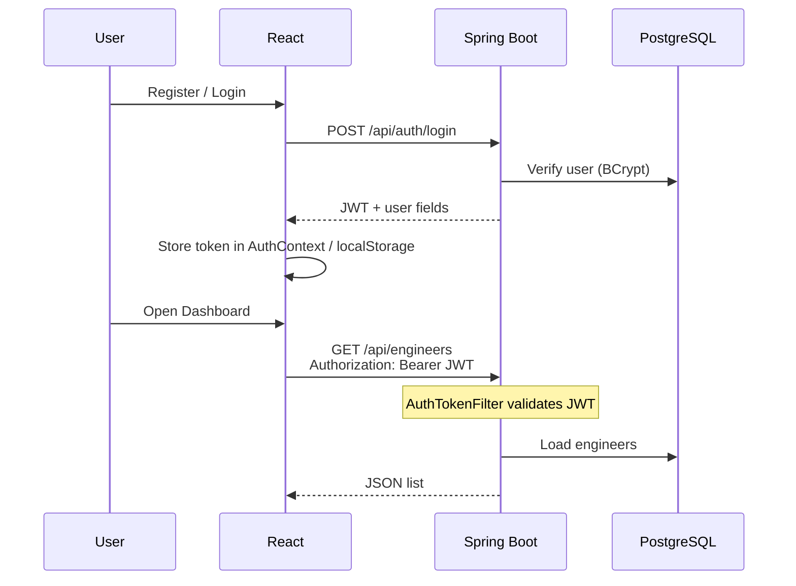
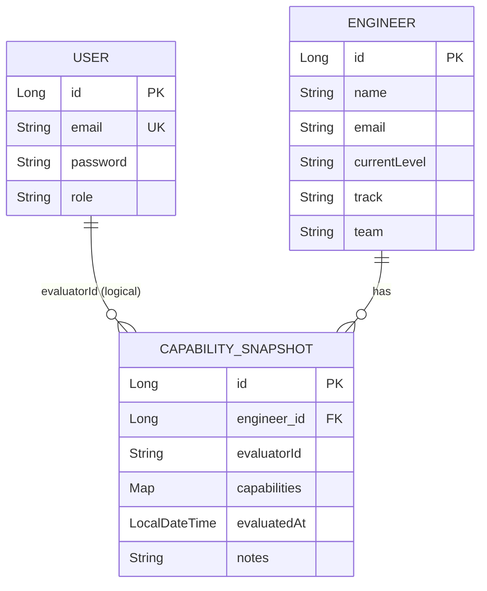

# NexaTalentOS — Architecture

Deep dive into how the system is designed and how data flows.

---

## 1. Overview

NexaTalentOS is a **full-stack talent management platform**:

- Managers authenticate with **JWT**
- They manage **engineer** profiles
- They submit **capability evaluations** (scores 0–4)
- The UI computes **promotion readiness** and shows **gaps + radar charts**

```text
Browser → React + Vite (:5173) → Spring Boot (:8080) → PostgreSQL
```


---

## 2. High-level components

| Component | Technology | Port / location | Responsibility |
|-----------|------------|-----------------|----------------|
| Frontend | React, TypeScript, Vite | `:5173` | UI, auth state, API calls, readiness math |
| Backend | Java 17+, Spring Boot 3 | `:8080` | REST APIs, security, business rules, persistence |
| Database | PostgreSQL | `:5432` / DB `nexatalentos` | Users, engineers, evaluation snapshots |

---

## 3. Frontend architecture

### Layers

```text
pages/          UI screens (Login, Dashboard, Profile, Evaluation, AddEmployee)
    ↓
contexts/       AuthContext (token + user in memory + localStorage)
    ↓
api/nexusApi.ts HTTP client (JSON + Bearer JWT)
    ↓
Backend /api/*
```

### Important modules

| Path | Role |
|------|------|
| `src/pages/*` | Screens and user flows |
| `src/contexts/AuthContext.tsx` | Login state; calls `setAuthToken` |
| `src/api/nexusApi.ts` | All REST calls to `http://localhost:8080/api` |
| `src/config/capabilities.ts` | Nine capability definitions |
| `src/config/levels.ts` | Level targets (L1–L6) for readiness |
| `src/utils/readinessCalculator.ts` | Score %, gaps, recommendations |
| `src/types/domain.ts` | Shared domain types (“frozen contracts”) |
| `src/components/charts/CapabilityRadar.tsx` | Recharts radar |

### How auth works on the frontend

1. User registers or logs in via `Login` page.
2. Backend returns a JWT.
3. `AuthContext.login(token, user)` stores:
   - token in `nexusApi` + `localStorage` (`authToken`)
   - user JSON in `localStorage` (`nexus-user`)
4. Later pages call `setAuthToken(token)` and use `nexusApi` helpers.
5. Logout clears token + user.

### Page → API mapping

| Page | Main API calls |
|------|----------------|
| Login | `POST /auth/register`, `POST /auth/login` |
| Dashboard | `GET /engineers` |
| Add Employee | `POST /engineers` (+ optional evaluation) |
| Evaluation | `GET /engineers`, `POST /evaluations` |
| Engineer Profile | `GET /evaluations/engineer/{id}/evaluations` |

---

## 4. Backend architecture

### Layered design

```text
HTTP request
    ↓
Security filter chain (CORS, JWT AuthTokenFilter)
    ↓
Controller     — map URL ↔ DTO, call service
    ↓
Service        — business logic
    ↓
Repository     — Spring Data JPA
    ↓
Entity         — maps to PostgreSQL tables
```

### Packages

| Package | Responsibility |
|---------|----------------|
| `controller` | `AuthController`, `EngineerController`, `EvaluationController` |
| `service` | `AuthService`, `EngineerService`, `EvaluationService` |
| `repository` | JPA repositories |
| `entity` | `User`, `Engineer`, `CapabilitySnapshot` |
| `dto` | Request/response objects |
| `security` | `JwtUtils`, `AuthTokenFilter`, `UserDetailsServiceImpl`, etc. |
| `config` | `SecurityConfig` |
| `exception` | Global error handling |

### API surface

| Method | Path | Access |
|--------|------|--------|
| `POST` | `/api/auth/register` | Public |
| `POST` | `/api/auth/login` | Public |
| `GET` | `/api/engineers` | EMPLOYER, ADMIN |
| `POST` | `/api/engineers` | EMPLOYER, ADMIN |
| `GET` | `/api/engineers/{id}` | Authenticated (role rules apply) |
| `PUT` | `/api/engineers/{id}` | EMPLOYER, ADMIN |
| `DELETE` | `/api/engineers/{id}` | ADMIN |
| `POST` | `/api/evaluations` | EMPLOYER, ADMIN |
| `GET` | `/api/evaluations/{id}` | EMPLOYER, ADMIN |
| `GET` | `/api/evaluations/engineer/{id}/evaluations` | EMPLOYER, ADMIN |
| `GET` | `/api/evaluations/engineer/{id}/latest` | EMPLOYER, ADMIN |
| `GET` | `/api/evaluations/engineer/{id}/history` | EMPLOYER, ADMIN |

---

## 5. Security design

### Goals

- Stateless API (no server session)
- Passwords hashed with **BCrypt**
- Access controlled by **JWT + roles**

### Roles

| Role | Typical access |
|------|----------------|
| `ADMIN` | Full (including delete engineers) |
| `EMPLOYER` | Engineers + evaluations |
| `CANDIDATE` | Limited |

### JWT sequence



### Filter chain (simplified)

1. CORS
2. `AuthTokenFilter` — read Bearer token, validate, set SecurityContext
3. Authorization rules from `SecurityConfig`
4. Controller

Public paths: `/api/auth/**`  
Protected paths: `/api/engineers/**`, `/api/evaluations/**` (role-dependent)

---

## 6. Data model



### Capability scores

Each snapshot stores nine skills on a **0–4** scale:

- SYSTEM_DESIGN  
- TECHNICAL_DEPTH  
- CODE_OWNERSHIP  
- DEBUGGING  
- COMMUNICATION  
- PRODUCT_THINKING  
- EXECUTION  
- MENTORSHIP  
- ARCHITECTURE_VISION  

### Level targets

`nexus-frontend/src/config/levels.ts` defines required scores per level (`L1`–`L6`).  
The profile page compares **latest snapshot** vs **next level target**.

---

## 7. Core workflows

### A. Register → Login → Dashboard

```text
Register → User row in DB
Login → JWT
Dashboard → GET /engineers → roster + stats
```

### B. Add engineer

```text
Add Employee form → POST /engineers → optional initial evaluation snapshot
```

### C. Evaluation → readiness

```text
Evaluation form (sliders)
    → POST /api/evaluations
    → CapabilitySnapshot saved
    → Profile loads evaluations
    → readinessCalculator + levels.ts
    → % score, gaps, radar chart
```

> **Design choice:** Snapshots are stored on the **backend**.  
> Readiness % / gaps are computed on the **frontend** today (see Roadmap to move this server-side).

---

## 8. Configuration

### Backend (`application.properties`)

| Setting | Purpose |
|---------|---------|
| `server.port=8080` | API port |
| `spring.profiles.active=prod` | Postgres profile |
| `DB_URL` / `DB_USERNAME` / `DB_PASSWORD` | Database connection |
| `app.jwt.secret` | JWT signing key |
| `app.jwt.expiration` | Token lifetime (ms) |
| `spring.jpa.hibernate.ddl-auto=update` | Auto schema update |

### Frontend

| Setting | Purpose |
|---------|---------|
| `VITE_API_BASE_URL` | Optional override (default `http://localhost:8080/api`) |

---

## 9. Design decisions (interview talking points)

1. **Layered backend** — Controllers stay thin; services own rules.
2. **Stateless JWT** — Easy to scale; every request carries auth.
3. **RBAC** — URL-level role checks in `SecurityConfig`.
4. **Immutable-ish evaluations** — New snapshot per evaluation (history preserved).
5. **Frozen contracts** — TypeScript types in `types/` should match API DTOs.
6. **Postgres for real data** — Default runtime is PostgreSQL (not H2).

---

## 10. Roadmap (architecture-related)

- [ ] Backend readiness / gap service (single source of truth)
- [ ] Docker Compose for local full stack
- [ ] Stronger API tests around auth + evaluations
- [ ] Optional refresh tokens / shorter-lived access tokens

---

## Related files

| Doc / asset | Path |
|-------------|------|
| Setup guide | [README.md](./README.md) |
| Architecture image | [docs/Architecture.png](./docs/Architecture.png) |
| Security config | `nexus-backend/.../config/SecurityConfig.java` |
| API client | `nexus-frontend/src/api/nexusApi.ts` |
