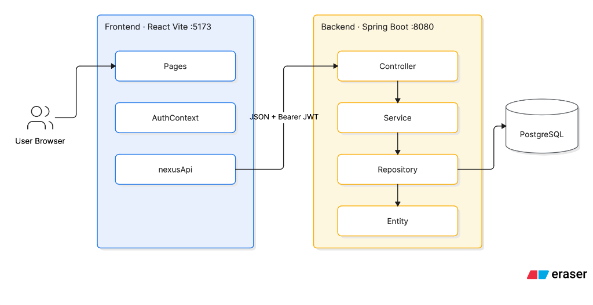
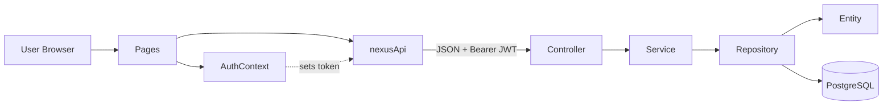

# NexaTalentOS

**Employee skill evaluation & promotion-readiness platform**

NexaTalentOS helps managers evaluate engineer competencies, find skill gaps, and decide promotion readiness 
with structured capability scores, saved assessment snapshots, and radar charts.

---

## Table of contents

1. [What it does](#what-it-does)
2. [Features](#features)
3. [Tech stack](#tech-stack)
4. [Architecture](#architecture)
5. [Prerequisites](#prerequisites)
6. [Fork & clone](#fork--clone)
7. [Database setup](#database-setup)
8. [How to run](#how-to-run)
9. [First-time usage](#first-time-usage)
10. [API overview](#api-overview)
11. [Roles](#roles)
12. [Project structure](#project-structure)
13. [Troubleshooting](#troubleshooting)
14. [Roadmap](#roadmap)
15. [Author](#author)

---

## What it does

In short:

1. Managers **register / sign in** (JWT).
2. They **add engineers** (name, level, track, team).
3. They **submit capability evaluations** (scores 0–4 for 9 skills).
4. The app stores **snapshots** and shows **readiness %**, **gaps**, and a **radar chart**.

---

## Features

| Area | What you get |
|------|----------------|
| Auth | Register & login with JWT |
| Security | Spring Security + BCrypt + role checks |
| Engineers | Create, list, view, update, delete |
| Evaluations | Submit scores, keep snapshot history |
| Dashboard | Team overview, roster search, simple stats |
| Profile | Readiness score, gaps, Recharts radar |
| UI | React + TypeScript + Vite |

**Nine capabilities (0–4):** System Design, Technical Depth, Code Ownership, Debugging, Communication, 
Product Thinking, Execution, Mentorship, Architecture Vision.

---

## Tech stack

| Layer | Technology |
|-------|------------|
| Frontend | React, TypeScript, Vite, Recharts |
| Backend | Java 17+, Spring Boot 3, Spring Security |
| Auth | JWT, BCrypt |
| Database | PostgreSQL, Spring Data JPA, Hibernate |
| Build | Maven (backend), npm (frontend) |
| Tools | Git |

> **Note:** `pom.xml` targets **Java 17**. On macOS, `./start-backend.sh` prefers **Java 21** if installed. 
Use **JDK 17 or newer**.

---

## Architecture

> Full design deep-dive: **[ARCHITECTURE.md](./ARCHITECTURE.md)**

### System diagram




| Part | What it means in code | Status |
|------|------------------------|--------|
| User Browser → Pages | User opens React screens (`Login`, `Dashboard`, etc.) | Correct |
| AuthContext | Holds JWT + user; syncs token into `nexusApi` | Correct |
| nexusApi | All HTTP calls to `/api/*` | Correct |
| JSON + Bearer JWT | Request body is JSON; header `Authorization: Bearer …` | Correct |
| Controller → Service → Repository → Entity | Standard Spring Boot layers | Correct |
| PostgreSQL | Primary database (`nexatalentos`) | Correct |

### Simple view

```text
  Browser → React (:5173) → Spring Boot (:8080) → PostgreSQL
                 │                  │
            Pages / AuthContext    Controller → Service → Repository → Entity
            nexusApi (JWT)         AuthTokenFilter (JWT check)
```

### Request flow (Mermaid)



### Auth (simple)

```text
  Register / Login
        ↓
  Backend returns JWT
        ↓
  Frontend saves token (AuthContext + localStorage)
        ↓
  API calls send: Authorization: Bearer <token>
        ↓
  AuthTokenFilter validates JWT → then Controller runs
```

### Main folders

| Side | Folders |
|------|---------|
| Frontend | `pages/`, `api/`, `contexts/`, `config/`, `utils/`, `components/` |
| Backend | `controller/`, `service/`, `repository/`, `entity/`, `security/`, `dto/` |

---

## Prerequisites

Install these before running:

| Tool | Version | Why |
|------|---------|-----|
| Java JDK | 17+ (21 recommended) | Backend |
| Node.js | 18+ | Frontend |
| npm | comes with Node | Frontend packages |
| PostgreSQL | 14+ | Database on `localhost:5432` |
| Git | any recent | Clone the repo |

---

## Fork & clone

### Option A — Fork (your own copy on GitHub)

1. Open [https://github.com/Someshdiwan/NexaTalent](https://github.com/Someshdiwan/NexaTalent)
2. Click **Fork**
3. Clone **your** fork:

```bash
git clone https://github.com/<YOUR_USERNAME>/NexaTalent.git
cd NexaTalent
```

### Option B — Clone this repo

```bash
git clone https://github.com/Someshdiwan/NexaTalent.git
cd NexaTalent
```

If you already have the project locally:

```bash
cd /path/to/NexaTalentOS
```

---

## Database setup

Do this **once**.

### 1. Start PostgreSQL

Make sure Postgres is running on port **5432**.

### 2. Create the database

```sql
CREATE DATABASE nexatalentos;
```

### 3. Connection defaults

| Variable | Default value |
|----------|----------------|
| `DB_URL` | `jdbc:postgresql://localhost:5432/nexatalentos` |
| `DB_USERNAME` | `postgres` |
| `DB_PASSWORD` | `nexus123` |

Change them if your Postgres user/password is different:

```bash
export DB_USERNAME='postgres'
export DB_PASSWORD='your_password'
export DB_URL='jdbc:postgresql://localhost:5432/nexatalentos'
```

### Important

- App uses **PostgreSQL only** (default profile is `prod`).
- Tables are created automatically (`ddl-auto=update`).
- **No seed users.** You must **Register** in the UI first.

---

## How to run

Use **two terminals** — backend first, then frontend.

### Terminal 1 — Backend

**Easy way:**

```bash
./start-backend.sh
```

**Manual way:**

```bash
export JAVA_HOME=$(/usr/libexec/java_home -v 21)   # macOS example; use your JDK 17+ path on Linux/Windows
export DB_PASSWORD='nexus123'
cd nexus-backend
./mvnw spring-boot:run
```

When it starts successfully:

- API → `http://localhost:8080`

### Terminal 2 — Frontend

**Easy way:**

```bash
./start-frontend.sh
```

**Manual way:**

```bash
cd nexus-frontend
npm install
npm run dev
```

When it starts successfully:

- App → [http://localhost:5173](http://localhost:5173)

---

## First-time usage

1. Open [http://localhost:5173](http://localhost:5173)
2. Click **Register** and create an account  
   - Tip: choose **Admin** or **Employer** so you can manage engineers
3. **Sign in** with the same email/password
4. Go to **New Employee** → add an engineer
5. Go to **New Evaluation** → rate capabilities
6. Open **Dashboard** → click an engineer → see readiness, gaps, and radar

---

## API overview

Base URL: `http://localhost:8080`

| Method | Path | Who can call |
|--------|------|----------------|
| `POST` | `/api/auth/register` | Anyone (public) |
| `POST` | `/api/auth/login` | Anyone (public) |
| `GET` | `/api/engineers` | EMPLOYER, ADMIN |
| `POST` | `/api/engineers` | EMPLOYER, ADMIN |
| `PUT` | `/api/engineers/{id}` | EMPLOYER, ADMIN |
| `DELETE` | `/api/engineers/{id}` | ADMIN only |
| `POST` | `/api/evaluations` | EMPLOYER, ADMIN |
| `GET` | `/api/evaluations/...` | EMPLOYER, ADMIN |

After login, every protected request needs:

```http
Authorization: Bearer <your-jwt-token>
```

Frontend API helper: `nexus-frontend/src/api/nexusApi.ts`

---

## Roles

| Role | Meaning |
|------|---------|
| `ADMIN` | Full access (including delete engineer) |
| `EMPLOYER` | Manage engineers and evaluations |
| `CANDIDATE` | Limited access |

Pick a role when you **register**.

---

## Project structure

```text
NexaTalentOS/
├── nexus-backend/                 # Spring Boot API
│   └── src/main/java/com/company/nexus/
│       ├── controller/            # REST endpoints
│       ├── service/               # Business logic
│       ├── repository/            # Database access
│       ├── entity/                # User, Engineer, CapabilitySnapshot
│       ├── security/              # JWT filter & utils
│       └── dto/                   # Request / response objects
├── nexus-frontend/                # React + Vite UI
│   └── src/
│       ├── pages/                 # Login, Dashboard, Profile, Evaluation, AddEmployee
│       ├── api/                   # HTTP client (nexusApi.ts)
│       ├── contexts/              # AuthContext
│       ├── config/                # Capability list + level targets
│       ├── types/                 # Domain types & API contracts
│       ├── utils/                 # Readiness calculator
│       └── components/            # Charts, forms, icons
├── docs/
│   └── architecture.png           # System architecture diagram
├── start-backend.sh               # One-command backend start
├── start-frontend.sh              # One-command frontend start
└── README.md
```

---

## Troubleshooting

| Problem | What to do |
|---------|------------|
| Postgres not running | Start PostgreSQL, then create DB `nexatalentos` |
| Port `8080` already in use | Stop the old Java process, or run `./start-backend.sh` again (it tries to free 8080) |
| Login fails / “user not found” | Database is empty — **Register** first |
| Frontend warning: backend not reachable | Start backend **before** frontend |
| Wrong Java | Set `JAVA_HOME` to JDK 17 or newer |
| DB password error | Export `DB_PASSWORD` to match your Postgres password |
| Don’t run backend + frontend in one terminal | Use **two terminals** |

---

## Roadmap

Planned improvements:

- [ ] Move readiness scoring from frontend to a backend service
- [ ] Evaluation history UI (timeline / export)
- [ ] Better UX for `CANDIDATE` role
- [ ] Automated tests (API + important UI flows)
- [ ] Docker Compose (Postgres + backend + frontend)
- [ ] Cloud deploy (e.g. Render / Railway + Vercel)

---

## Author

**Somesh Diwan**

- GitHub: [https://github.com/Someshdiwan](https://github.com/Someshdiwan)
- Project: [https://github.com/Someshdiwan/NexaTalent](https://github.com/Someshdiwan/NexaTalent)

---
