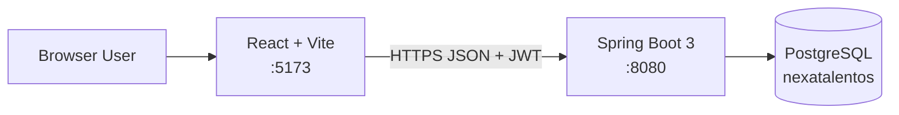
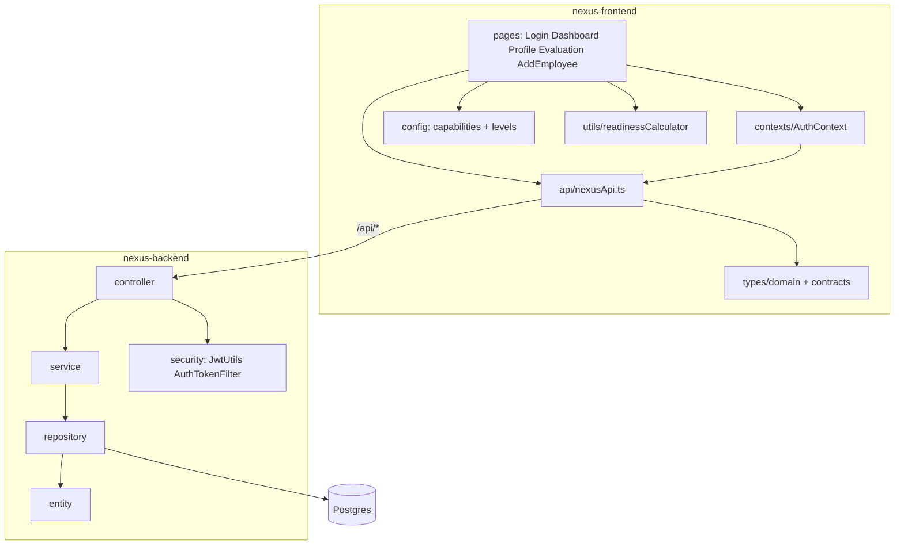
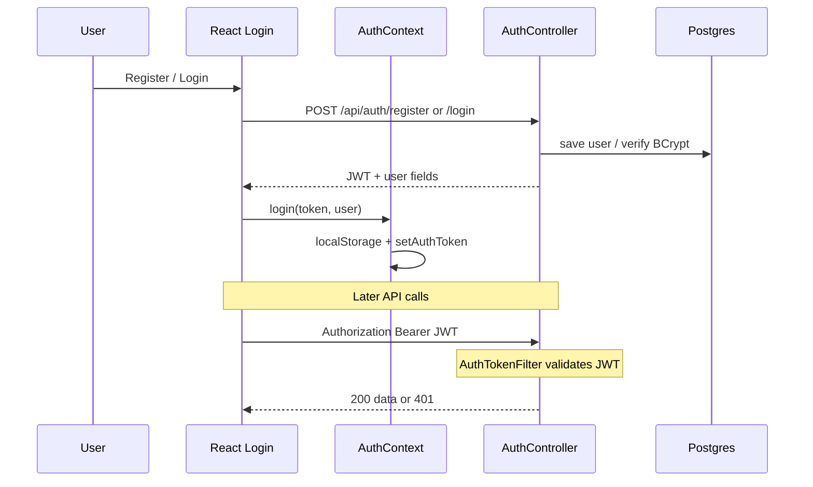
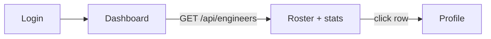
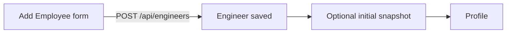
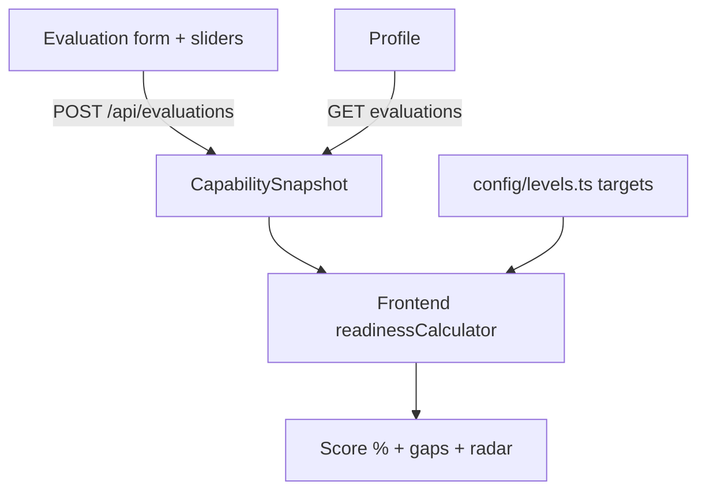

# NexaTalentOS : Architecture & Workflow Guide

Engineering talent OS: register/login → manage engineers → submit capability evaluations → view promo readiness.

## 1. High-level system



| Layer | Stack |
|--------|--------|
| Frontend | React, TypeScript, Vite, AuthContext |
| Backend | Java 21, Spring Boot 3, Security + JWT |
| Data | Postgres, JPA/Hibernate |
| Auth | BCrypt passwords, JWT (24h), role-based access |

---

## 2. Folder / layer map



**Request path (backend):**  
`Controller → Service → Repository → Entity → DB`  
Response DTOs go back as JSON.

---

## 3. Data model

```mermaid
erDiagram
  USER ||--o{ CAPABILITY_SNAPSHOT : evaluates
  ENGINEER ||--o{ CAPABILITY_SNAPSHOT : has

  USER {
    id PK
    email
    password_hash
    role ADMIN_EMPLOYER_CANDIDATE
  }

  ENGINEER {
    id PK
    name email
    level L1_L6
    track IC_LEADERSHIP_PRODUCT
    team
  }

  CAPABILITY_SNAPSHOT {
    id PK
    engineer_id FK
    evaluator_id
    capabilities_json_0_to_4
    evaluated_at
    notes
  }
```

Capabilities (0–4): System Design, Technical Depth, Code Ownership, Debugging, Communication, Product Thinking, 
Execution, Mentorship, Architecture Vision.

---

## 4. Auth & JWT workflow



**Roles**
- `ADMIN` — full (incl. delete engineers)
- `EMPLOYER` — engineers + evaluations
- `CANDIDATE` — limited (auth only for most APIs)

`/api/auth/**` is public; everything else needs a valid JWT + role.

---

## 5. Main product workflows

### A. Dashboard


### B. Add engineer


### C. Evaluation → readiness


Readiness is computed on the **frontend** from latest snapshot vs `TARGET_PROFILES` in `config/levels.ts`.

---

## 6. API surface (cheat sheet)

| Method | Path | Who |
|--------|------|-----|
| POST | `/api/auth/register` | public |
| POST | `/api/auth/login` | public |
| GET/POST/PUT | `/api/engineers` | EMPLOYER, ADMIN |
| DELETE | `/api/engineers/{id}` | ADMIN |
| POST/GET | `/api/evaluations…` | EMPLOYER, ADMIN |

Frontend client: `nexus-frontend/src/api/nexusApi.ts` (attaches Bearer token).

---

## 7. Run locally

```bash
./start-backend.sh    # Postgres, port 8080, password nexus123
./start-frontend.sh   # http://localhost:5173
```

Register first (DB starts empty). No seed `DataLoader`.

---

## 8. Interview talking points

1. **Stateless JWT** — no server sessions; filter validates each request
2. **Layered backend** — controllers stay thin; services own rules
3. **Frozen contracts** — TS types mirror API shapes
4. **Separation** — persist evaluations in DB; derive readiness in UI
5. **RBAC** — Spring Security method/URL roles

---

## 10. What to learn next (order)

1. JWT: create → send → filter → 401
2. One CRUD path: create engineer end-to-end
3. Evaluation snapshot shape in DB vs UI
4. Why readiness is client-side vs moving it to a service
